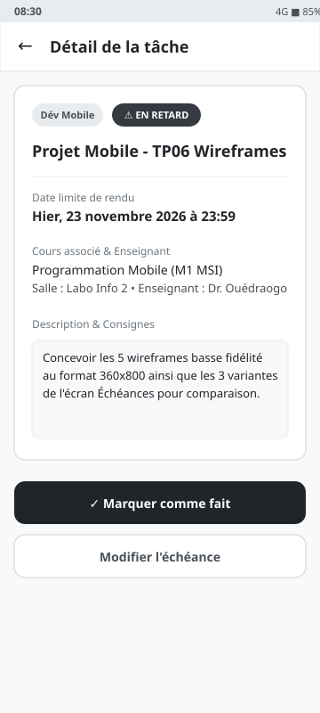
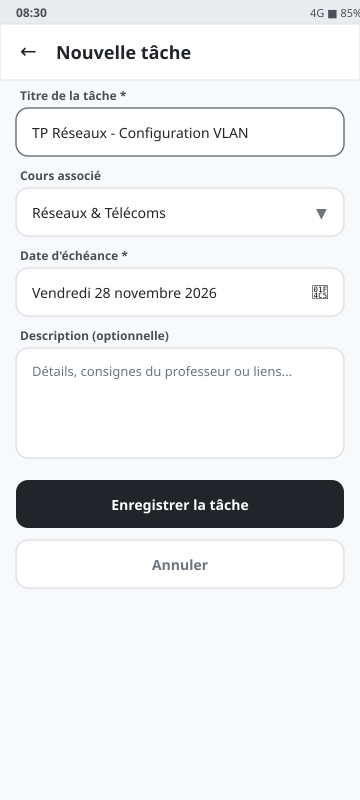
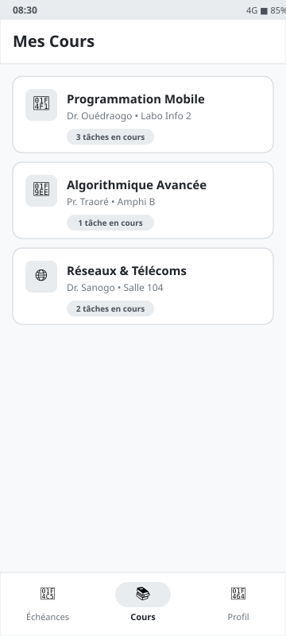
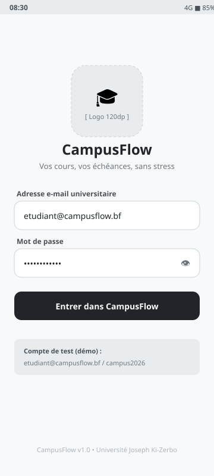
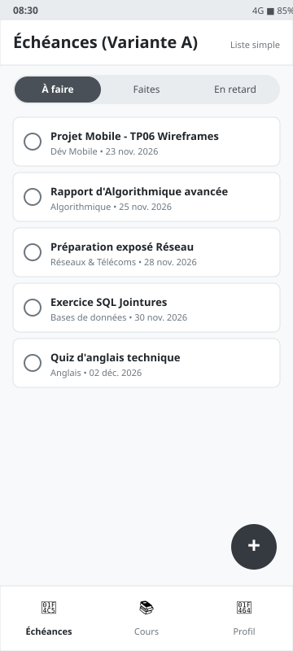
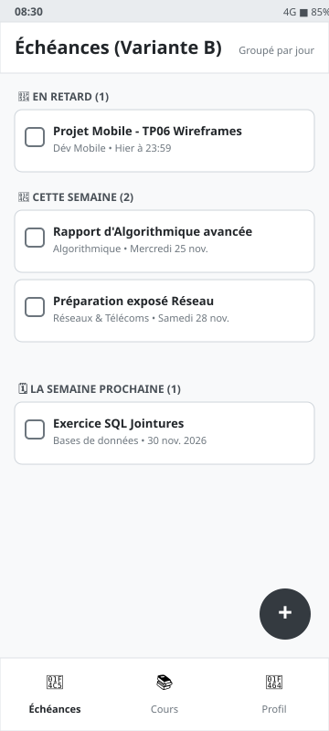
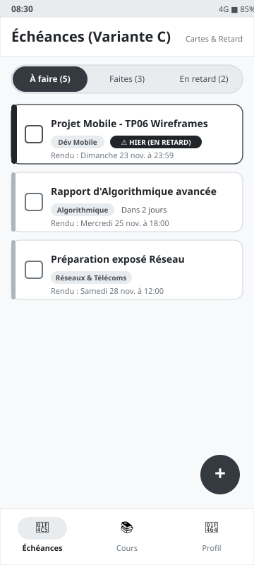

# Séance 2 — Galerie des Wireframes CampusFlow

Retrouvez ci-dessous l'ensemble des wireframes basse fidélité (format 360 × 800 dp, niveaux de gris) conçus pour CampusFlow.

---

## 1. Écrans principaux de l'application

| Écran | Wireframe | Description |
|:---|:---:|:---|
| **01. Échéances (Accueil)** |  | Liste des devoirs avec filtres (À faire, Faites, En retard), bouton d'action flottant (+), et barre de navigation 3 onglets. |
| **02. Détail d'une tâche** |  | Fiche détaillée (titre, cours, date limite, consignes) et bouton d'action principal « Marquer comme fait ». |
| **03. Nouvelle tâche** |  | Formulaire de saisie avec validation du titre, choix du cours (menu déroulant), date limite (DatePicker) et description. |
| **04. Mes Cours** |  | Répertoire des cours suivis avec enseignant référent, salle de cours et nombre d'échéances associées. |
| **05. Connexion (Login)** |  | Écran d'accueil avec logo CampusFlow (120 dp), saisie e-mail / mot de passe et rappel du compte de démonstration. |

---

## 2. Variantes explorées pour l'écran Échéances

| Variante | Wireframe | Caractéristiques principales |
|:---|:---:|:---|
| **Variante A** *(Liste simple)* |  | Liste continue ultra-compacte, tuiles simples avec case à cocher, affichage chronologique sans mise en valeur particulière. |
| **Variante B** *(Groupé par jour)* |  | Regroupement des devoirs par sections temporelles (« En retard », « Cette semaine », « La semaine prochaine »). |
| **Variante C** *(Cartes &amp; Retard)* |  | Cartes structurées avec badges de statut, liseré latéral contrasté pour les retards et filtres chiffrés. *(Variante recommandée)* |

---

> Pour l'analyse comparative détaillée et la grille de notation de ces trois variantes, consultez [docs/seance2/06_choix_variante.md](../06_choix_variante.md).
